# Trabalho Prático 1: EduMIPS64

Arquitetura de Computadores II, GCC123/PCC507
Grupo 6:

> Bernado Henrique Diniz Felix
> Guilherme dos Santos Cordeiro
> Guilherme Genicy Camargos Silva
> Filipe Rezende Silva
> Luis Felipe Costa Teixeira

**Composição do grupo:** cinco integrantes, conforme exceção autorizada pelo professor para este grupo. A relação de nomes foi preservada sem alterações.

## 1. Introdução e construção do simulador

Neste trabalho, usamos o EduMIPS64 para acompanhar o que acontece com cada instrução dentro do pipeline. Não basta o programa dar o resultado certo: queremos entender quando uma instrução consegue avançar, quando precisa esperar e como essa espera aumenta o número de ciclos. Para isso, comparamos o código com forwarding desligado e ligado e conferimos os resultados nos registradores.

O EduMIPS64 simula parte do conjunto de instruções MIPS64 e foi feito para estudar arquitetura de computadores. Ele permite executar uma instrução por vez e ver os registradores, a memória e os estágios do pipeline. Isso ajuda a entender casos como o nosso `LD` seguido de `DADD`: a soma depende do dado carregado e pode precisar esperar por ele.

### 1.1 Histórico e tecnologias

O projeto começou em 2006 com estudantes da Universidade de Catania, na Itália. A ideia inicial era criar uma alternativa ao WinMIPS64 que não ficasse limitada ao Windows. Por isso, o simulador foi desenvolvido em Java e depois passou a seguir como um projeto próprio de software livre.

A parte que simula a CPU é escrita em Java. Na versão Desktop tradicional, a interface usa Swing. Na versão Web que usamos, a interface usa React e o núcleo Java é compilado para JavaScript, rodando em um Web Worker. Também existe uma distribuição com Electron. O que muda entre essas opções é principalmente a forma de acessar e visualizar o simulador.

### 1.2 Desktop e Web

| Aspecto | Desktop tradicional | Web utilizada neste trabalho |
|---|---|---|
| Acesso | Aplicação Java local | Navegador em `web.edumips.org` |
| Interface | Janelas e menus Swing | Editor e painéis de execução |
| Acompanhamento | Quadros de ciclos, registradores e memória | Painéis Stats, Pipeline, Registers, Memory e Cycles |
| Experimentos | Configurações do simulador local | Configurações acessíveis pelo botão de engrenagem |

Usamos somente a versão Web. Portanto, as comparações deste relatório são entre configurações do simulador, não entre Desktop e Web nem entre processadores reais.

### 1.3 Visualização do pipeline

O painel Pipeline mostra onde as instruções estão naquele ciclo. Já o painel Cycles mostra o caminho que cada uma percorreu ao longo da execução. Por isso, colocamos os prints de Cycles no relatório: neles conseguimos ver as instruções avançando e os pontos marcados como RAW. Quando o programa termina, o Pipeline fica vazio, mas o histórico em Cycles continua disponível.

| Estágio | Função no pipeline inteiro analisado |
|---|---|
| IF | Busca da instrução |
| ID | Decodificação e leitura dos operandos; decisão dos desvios neste simulador |
| EX | Operação da ALU ou cálculo do endereço efetivo |
| MEM | Acesso à memória de dados quando necessário |
| WB | Escrita do resultado no registrador de destino, quando a instrução possui esse resultado |

Passar por MEM não significa que toda instrução acessa a memória. O `DADD`, por exemplo, faz a soma em EX e apenas passa por MEM antes de escrever o resultado em WB. Esses cinco estágios são do modelo analisado, não uma regra para todo processador que execute MIPS64.

## 2. Descrição da ISA utilizada

### 2.1 Registradores e tamanho das instruções

No MIPS64 temos 32 registradores inteiros, de `R0` a `R31`, e 32 de ponto flutuante, de `F0` a `F31`, todos de 64 bits. O `R0` sempre vale zero. Também existem registradores especiais, como o PC, que indica o endereço da instrução a buscar, e HI e LO. Nos nossos microexperimentos, usamos apenas os registradores inteiros.

Os registradores são de 64 bits, mas as instruções usadas têm 32 bits. São duas coisas diferentes: a instrução diz qual operação fazer e quais registradores usar; o registrador guarda o dado da operação. Então, um `DADD` de 32 bits pode mandar somar valores de 64 bits. A versão Web permite consultar a codificação da instrução depois de carregá-la.

### 2.2 Características RISC e formatos

Uma característica RISC presente no código é a separação entre cálculo e acesso à memória. O `DADD` soma valores dos registradores, não busca diretamente um valor na memória. Se o dado está na memória, primeiro usamos um load para trazê-lo ao registrador. Para guardar um resultado de volta na memória, usamos um store. Isso fica claro no experimento 4.3, em que o `LD` carrega o valor 7 antes da soma.

| Formato | Campos da codificação clássica | Aplicação |
|---|---|---|
| R | opcode: 6; rs: 5; rt: 5; rd: 5; shamt: 5; funct: 6 bits | Operação entre registradores, como `DADD` |
| I | opcode: 6; rs: 5; rt: 5; imediato: 16 bits | `DADDI`, `LD` e desvio `BNE` |
| J | opcode: 6; campo de destino: 26 bits | Saltos como `J`; não utilizado nos microexperimentos |

O opcode ajuda a identificar o que a instrução faz; no tipo R, o campo funct também participa dessa identificação. Os campos de registrador dizem quais registradores usar, não carregam seus conteúdos. Já o imediato muda de função conforme a instrução: em `DADDI R1,R0,10`, ele é o número 10 a somar; em `LD R1,0(R2)`, ele é o deslocamento zero do endereço.

### 2.3 Instruções e diretivas utilizadas

| Elemento | Efeito e finalidade |
|---|---|
| `DADDI rt,rs,imm` | Soma inteira de 64 bits com imediato e resultado em `rt` |
| `DADD rd,rs,rt` | Soma inteira de 64 bits entre fontes `rs` e `rt`, com resultado em `rd` |
| `LD rt,offset(base)` | Lê 64 bits da memória no endereço `base + offset` e escreve em `rt` |
| `SD rt,offset(base)` | Grava os 64 bits de `rt` na memória no endereço `base + offset` |
| `DMUL rd,rs,rt` | Multiplica inteiros de 64 bits e coloca os 64 bits inferiores do resultado em `rd` |
| `DSLL rd,rt,sa` | Desloca bits para a esquerda; usamos deslocamento 3 para multiplicar um índice por 8 |
| `BEQ rs,rt,Fim` | Desvia quando os valores dos registradores são iguais |
| `BNE rs,rt,Loop` | Desvia para `Loop` se os valores lidos forem diferentes |
| `SYSCALL 0` | Solicita o encerramento da simulação |
| `.data` | Inicia a seção de dados |
| `.word 7` | Reserva e inicializa um dado de 64 bits no EduMIPS64 |
| `.space n` | Reserva `n` bytes para armazenar resultados |
| `.code` | Inicia a seção de instruções |

`.data`, `.word` e `.code` organizam o arquivo, mas não entram no pipeline como instruções. No EduMIPS64, `.word` reserva 64 bits, então usamos `valor: .word 7` para o dado do load. Para encerrar, usamos `SYSCALL 0` em vez de `HALT`, evitando o aviso de compatibilidade do montador.

Não há instrução lógica explícita nestes microexperimentos. A comparação de valores realizada por `BNE` faz parte do controle de fluxo, não de uma operação lógica que produza resultado em um registrador.

### 2.4 Uso dos registradores

| Experimento | Registradores e funções |
|---|---|
| 4.1 | `R1` a `R4`: resultados independentes 10, 20, 30 e 40; `R0`: zero |
| 4.2 | `R1` a `R4`: cadeia de resultados dependentes; `R0`: zero |
| 4.3 original | `R2`: endereço de `valor`; `R1`: dado carregado; `R4`: parcela inicialmente zero; `R3`: resultado |
| 4.3 com instrução independente | Mesmas funções da versão original e `R5`: resultado independente 100 |
| 4.4 | `R1`: contador regressivo; `R2`: número de iterações realizadas; `R0`: zero para inicialização e comparação |

Em `LD R1,0(R2)`, o `R2` guarda o endereço de onde queremos ler. O processador soma esse endereço com zero, busca o dado na memória e coloca o valor em `R1`. Portanto, `R2` é a base do endereço e `R1` recebe o dado. Um store faria o contrário: pegaria um valor do registrador e o gravaria na memória.

## 3. Metodologia experimental

### 3.1 Organização dos experimentos

Usamos códigos pequenos para estudar um problema de cada vez. Primeiro, quatro instruções sem dependência; depois, uma cadeia RAW; em seguida, um load seguido de soma; por último, um laço com desvio. Em cada comparação OFF/ON, mantivemos o mesmo código. No 4.3 também testamos uma segunda versão, com uma instrução independente entre o load e a soma.

Na seção 4, separamos o comportamento esperado do que apareceu no simulador. Essa parte foi organizada depois das execuções, então não temos um registro de todas as previsões escrito antes da primeira simulação.

| Experimento | Dependências e hazards analisados | Comportamento teórico esperado |
|---|---|---|
| 4.1 | Nenhuma dependência entre as quatro operações | Sobreposição sem stalls de dados |
| 4.2 | RAW em `R1`, `R2` e `R3` | Espera sem forwarding; encaminhamento dos resultados da ALU com forwarding |
| 4.3 | RAW de endereço em `R2` e load-use em `R1` | O load-use pode exigir espera mesmo com forwarding; uma instrução independente pode ocupar esse intervalo |
| 4.4 | RAW no contador usado pelo branch; hazard de controle | Espera pelo operando do desvio e descarte do caminho sequencial nos desvios tomados |

Ter dependência não significa necessariamente parar. Na cadeia de somas do 4.2, por exemplo, uma instrução precisa do resultado da anterior, mas o forwarding entrega esse valor sem bolha. No load-use do 4.3, o dado fica pronto mais tarde e ainda há uma espera. WAR e WAW também precisam ser analisadas junto da ordem de execução, não apenas pelo nome dos registradores.

### 3.2 Configurações mantidas constantes

| Parâmetro | Configuração |
|---|---|
| Interface | EduMIPS64 Web em `https://web.edumips.org/` |
| Forwarding | OFF e ON, em execuções separadas |
| Branch Delay Slot | Desligado |
| Cache L1 de instruções | 1024 bytes; bloco de 16 bytes; associatividade 1 |
| Cache L1 de dados | 1024 bytes; bloco de 16 bytes; associatividade 1 |
| Entrada do experimento 4.3 | Dado `valor = 7` |
| Entrada do experimento 4.4 | Contador inicial 10 |
| Encerramento | `SYSCALL 0` em todos os códigos |

Não registramos o identificador exato da versão Web nas capturas. Os parâmetros usados estão na tabela, mas uma atualização do simulador pode mudar algum resultado. Também usamos as latências do próprio EduMIPS64, não as de outros exercícios da disciplina.

### 3.3 Procedimento de execução e coleta

1. Selecionar o arquivo `.s` do microexperimento e inserir seu conteúdo no editor.
2. Abrir Settings, selecionar Simulation e definir CPU Forwarding como OFF ou ON, mantendo Branch Delay Slot desligado.
3. Carregar o programa com Load, reiniciando o estado para evitar aproveitar resultados de outra execução.
4. Usar Single Step para acompanhar ciclos específicos ou Run All para executar até o término.
5. Conferir o resultado funcional no painel Registers e, quando aplicável, os dados em Memory.
6. Registrar IC, CC, CPI e contadores de stalls no painel Stats.
7. Capturar também o painel Cycles, que mostra o percurso temporal das instruções.
8. Repetir com a outra configuração de forwarding, sem modificar o código ou a entrada.

Montamos as tabelas juntando os números de cada execução. O EduMIPS64 não gera essa comparação OFF/ON pronta: ele mostra os resultados de uma execução por vez em Stats. Os prints de Cycles mostram onde as esperas aconteceram.

### 3.4 Métricas e limites da análise

Foram utilizadas as seguintes relações:

```text
CPI = CC / IC
Speedup = CC_referência / CC_comparado
```

Comparamos o desempenho pelo número de ciclos, considerando o mesmo período de clock. Não usamos o tempo que o navegador levou para executar. Também contamos o `SYSCALL 0`, porque ele aparece no total de instruções do simulador.

Para estas sequências inteiras, a referência sem stalls é `IC + 4`, correspondente aos cinco estágios. No laço, a contribuição líquida de controle foi calculada por:

```text
Penalidade líquida de controle = CC - (IC + 4) - stalls RAW
Proporção de controle = penalidade líquida de controle / CC
```

No nosso laço, os contadores WAW e structural stalls ficaram em zero. Por isso, tiramos do total os ciclos do pipeline ideal e as esperas RAW para analisar o que sobrou de penalidade de controle, conferindo com o diagrama. Esse número foi calculado por nós, pois o painel Web não mostrou um contador separado de branch stalls. Não usamos essa conta como regra para qualquer pipeline.


# 4. Parte I: Microexperimentos Obrigatórios

## Configuração e método

Executamos os códigos no EduMIPS64 Web, mudando somente `CPU Forwarding` entre OFF e ON. Mantivemos `Branch Delay Slot` desligado e as mesmas configurações de cache. Todos os códigos terminam com `SYSCALL 0`, que também entra na contagem de instruções.

Para calcular o CPI, dividimos os ciclos pelas instruções: `CPI = CC / IC`. Os números vieram do painel Stats. Já a penalidade de controle foi calculada à parte, porque não apareceu como um contador separado nesse painel.

## 4.1 Experimento 1: Pipeline sem dependências

**Objetivo.** Ver como quatro instruções avançam quando nenhuma precisa do resultado da outra.

**Arquivo:** [exp1_pipeline_ideal.s](microexperimentos/exp1_pipeline_ideal.s)

Cada `DADDI` soma uma constante com `R0` e grava em um registrador diferente: `R1`, `R2`, `R3` e `R4`. Como `R0` sempre vale zero, nenhuma precisa esperar um valor produzido pela outra. Depois dessas quatro operações, o `SYSCALL 0` encerra o programa.

**Diagrama de ciclos observado no EduMIPS64 (forwarding OFF):**


| Instrução | Entrada em IF | Saída em WB |
|---|---:|---:|
| `I1 DADDI` | 1 | 5 |
| `I2 DADDI` | 2 | 6 |
| `I3 DADDI` | 3 | 7 |
| `I4 DADDI` | 4 | 8 |
| `I5 SYSCALL` | 5 | 9 |

**Previsão.** Não devem ocorrer stalls RAW. O resultado deve ser igual com forwarding OFF e ON.

**Observado.** As quatro operações produziram `R1=10`, `R2=20`, `R3=30` e `R4=40`.

| Forwarding | IC | CC | RAW stalls | WAW stalls | Structural stalls | CPI |
|---|---:|---:|---:|---:|---:|---:|
| OFF | 5 | 9 | 0 | 0 | 0 | 1,80 |
| ON | 5 | 9 | 0 | 0 | 0 | 1,80 |

Foram cinco instruções contando o encerramento, executadas em nove ciclos: `5 + 4 = 9`. O CPI ficou `9/5 = 1,80`. Ele não chega a 1 porque o código é curto e ainda precisamos dos ciclos para encher e esvaziar o pipeline. No diagrama, entra uma instrução nova por ciclo, sem paradas. Como não há resultado para adiantar entre essas operações, ligar o forwarding não mudou nada.

**Execução com forwarding OFF:**


**Execução com forwarding ON:**

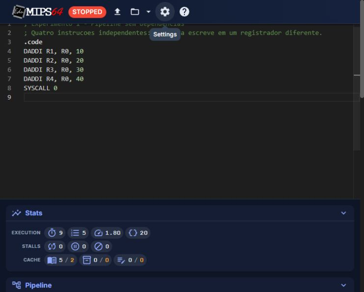

Diagrama de ciclos da execução:


## 4.2 Experimento 2: Dependências RAW e forwarding

**Objetivo.** Ver o que muda quando cada soma precisa do resultado da anterior, com e sem forwarding.

**Arquivo:** [exp2_raw_forwarding.s](microexperimentos/exp2_raw_forwarding.s)

| Produtora | Consumidora | Registrador |
|---|---|---|
| `I1 DADDI` | `I2 DADD` | `R1` |
| `I2 DADD` | `I3 DADD` | `R2` |
| `I3 DADD` | `I4 DADD` | `R3` |

**Previsão.** `I2` precisa de `R1`, produzido por `I1`; `I3` precisa de `R2`, produzido por `I2`; e `I4` precisa de `R3`, produzido por `I3`. Sem forwarding, esperamos paradas até esses valores serem escritos nos registradores. Com forwarding, o resultado da ALU pode seguir direto para a operação que precisa dele.

**Observado.** O resultado final foi `R1=10`, `R2=10`, `R3=10` e `R4=10` nas duas configurações.

| Forwarding | IC | CC | RAW stalls | CPI |
|---|---:|---:|---:|---:|
| OFF | 5 | 15 | 6 | 3,00 |
| ON | 5 | 9 | 0 | 1,80 |

Com forwarding OFF, apareceram duas esperas em cada uma das três dependências: `3 × 2 = 6` stalls. O total ficou `5 + 4 + 6 = 15` ciclos, com CPI `15/5 = 3,00`. Com forwarding ON, as seis esperas desapareceram e o código terminou em nove ciclos, com CPI `9/5 = 1,80`. O resultado continuou igual; só mudou o tempo para chegar nele. O ganho foi `15/9 = 1,67` vezes.

**Execução com forwarding OFF:**


Diagrama de ciclos da execução:

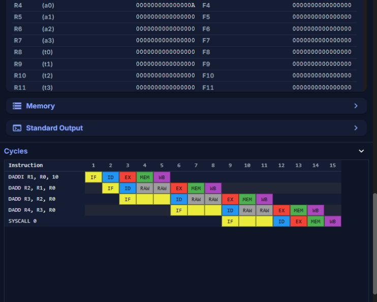

**Execução com forwarding ON:**

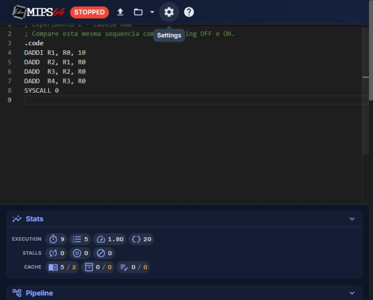

Diagrama de ciclos da execução:

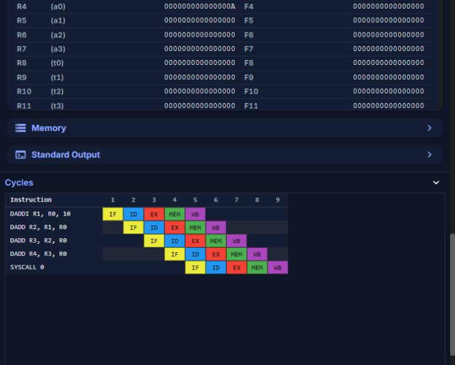

## 4.3 Experimento 3: Dependência após carregamento

**Objetivo.** Entender por que uma soma logo depois de um load ainda pode precisar de uma bolha, mesmo com forwarding, e testar uma instrução independente nesse intervalo.

**Versão original:** [exp3_load_use.s](microexperimentos/exp3_load_use.s)  
**Versão com instrução independente:** [exp3_load_use_reordered.s](microexperimentos/exp3_load_use_reordered.s)

Na versão original, `LD R1,0(R2)` busca o valor 7 na memória e coloca em `R1`. Logo depois, `DADD R3,R1,R4` precisa desse valor para somar. O problema é o momento em que ele fica pronto: o load só entrega o dado no final de MEM, enquanto a soma seguinte já precisaria dele em EX. O forwarding não consegue entregar um dado antes de ele existir, então ainda aparece uma bolha. Sem forwarding, a soma espera a escrita no banco de registradores.

Na segunda versão, colocamos `DADDI R5,R0,100` entre o load e a soma. Ela não usa `R1`, então consegue executar enquanto esperamos o dado do load. Nas duas versões, `R3` continua recebendo `7 + 0 = 7`. A diferença é que a segunda também deixa `R5 = 100`.

| Versão | Forwarding | IC | CC | RAW stalls | CPI |
|---|---|---:|---:|---:|---:|
| Original | OFF | 4 | 12 | 4 | 3,00 |
| Original | ON | 4 | 9 | 1 | 2,25 |
| Reordenada | OFF | 5 | 12 | 3 | 2,40 |
| Reordenada | ON | 5 | 9 | 0 | 1,80 |

Na versão original sem forwarding, tivemos duas esperas para o `LD` usar o endereço preparado em `R2` e mais duas para a soma usar `R1`: quatro stalls no total. Com forwarding, a espera pelo endereço desapareceu, mas sobrou uma no load-use. Ao inserir a instrução independente, essa última espera também desapareceu com forwarding ON. Mesmo assim, as duas versões levaram nove ciclos: acrescentamos uma instrução que ocupou o lugar da bolha. O CPI caiu de `9/4 = 2,25` para `9/5 = 1,80`, mas o tempo em ciclos não diminuiu.

| Comparação | Speedup por ciclos |
|---|---:|
| Original OFF → ON | `12/9 = 1,33` |
| Reordenada OFF → ON | `12/9 = 1,33` |
| Original ON → Reordenada ON | `9/9 = 1,00` |

A `DADDI R5` serve aqui para testar esse preenchimento. Para otimizar um programa de verdade, o melhor seria mover uma instrução útil que já estivesse no código, em vez de acrescentar uma operação só para ocupar o intervalo.

**Versão original, forwarding OFF:**

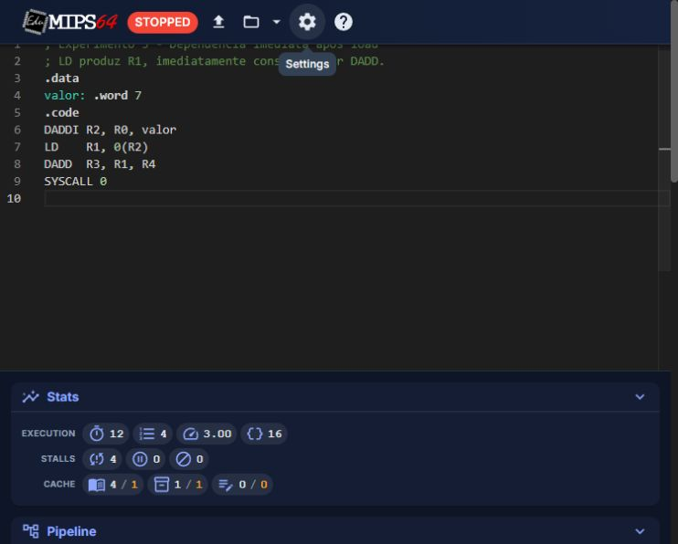

Diagrama de ciclos da execução:

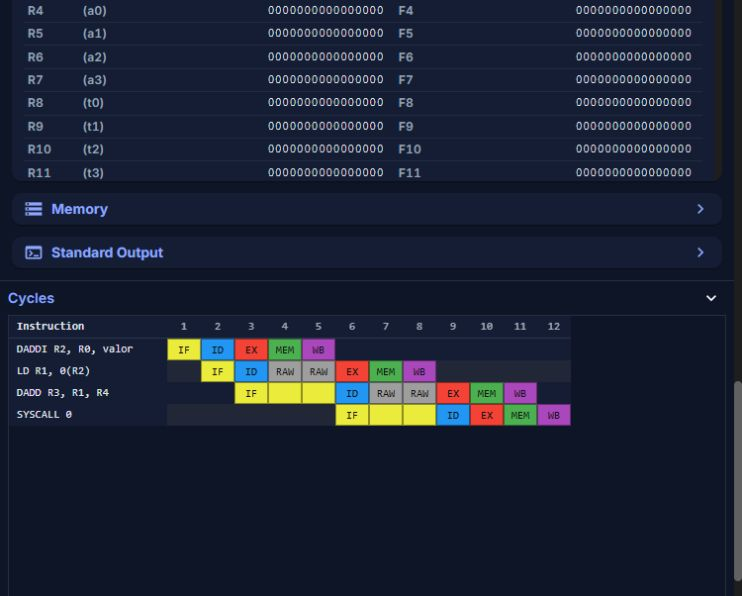

**Versão original, forwarding ON:**


Diagrama de ciclos da execução:

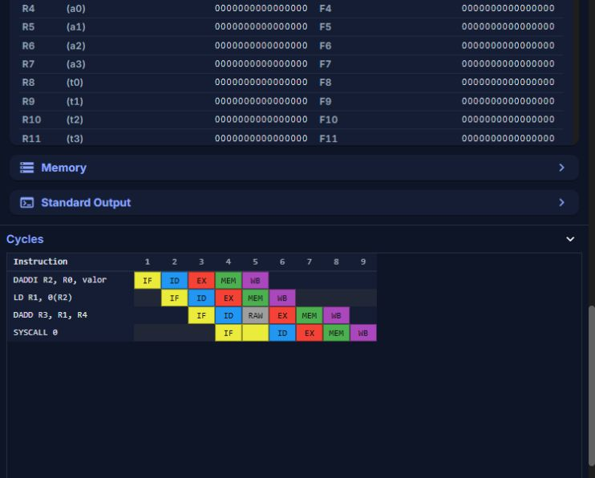

**Versão com instrução independente, forwarding OFF:**

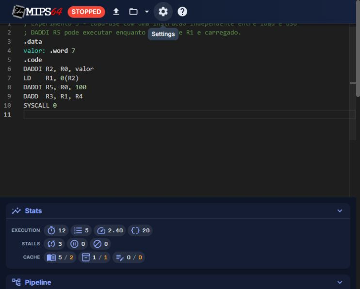

Diagrama de ciclos da execução:

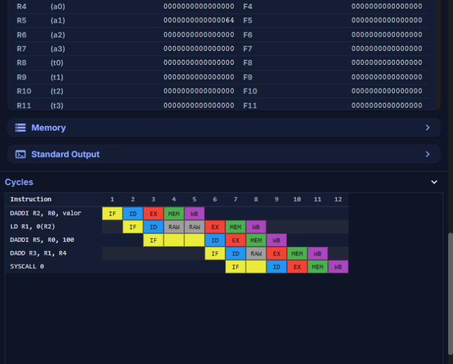

**Versão com instrução independente, forwarding ON:**


Diagrama de ciclos da execução:


## 4.4 Experimento 4: Hazard de controle

**Objetivo.** Ver como o desvio do laço e a espera pelo seu registrador afetam os ciclos, com e sem forwarding.

**Arquivo:** [exp4_branch_hazard.s](microexperimentos/exp4_branch_hazard.s)

Começamos com `R1 = 10` e `R2 = 0`. A cada volta, somamos 1 em `R2` e tiramos 1 de `R1`. O `BNE R1,R0,Loop` manda voltar enquanto `R1` for diferente de zero. Assim, executamos o teste dez vezes: voltamos nas primeiras nove e saímos na última. No final, conferimos `R1 = 0` e `R2 = 10`.

Antes de decidir se volta, o `BNE` precisa ler o novo `R1`, que acabou de ser alterado pelo `DADDI`. Esse teste acontece em ID. Como o simulador não tem forwarding direto para ID, ainda precisamos de uma espera por teste com forwarding ON. Com OFF, são duas. Também tivemos duas esperas extras, com OFF, entre zerar `R2` e fazer seu primeiro incremento. Portanto, os stalls RAW foram `10 × 2 + 2 = 22` com OFF e `10 × 1 = 10` com ON.

| Forwarding | IC | CC | RAW stalls | CPI |
|---|---:|---:|---:|---:|
| OFF | 33 | 68 | 22 | 2,06 |
| ON | 33 | 56 | 10 | 1,70 |

Além de esperar pelo valor de `R1`, temos a penalidade de voltar para o início do laço. Para separar essa parte, usamos os 33 comandos executados e tiramos do total os quatro ciclos de enchimento/esvaziamento e os stalls RAW. Como não há contador separado de branch stalls no painel Web, essa é uma conta feita a partir dos resultados:

| Forwarding | Penalidade líquida de controle |
|---|---:|
| OFF | `68 - 33 - 4 - 22 = 9` ciclos |
| ON | `56 - 33 - 4 - 10 = 9` ciclos |

Sobraram nove ciclos de penalidade de controle nas duas configurações, um para cada volta tomada nesta execução. O forwarding reduziu a espera pelos dados, de 22 para 10 stalls, mas não eliminou a penalidade de mudar o caminho do programa. Por isso, o total caiu de 68 para 56 ciclos.

Esses nove ciclos representam `9/68 × 100 = 13,24%` do total com OFF e `9/56 × 100 = 16,07%` com ON. A porcentagem aumentou, mas isso não significa que o desvio ficou pior: continuou custando nove ciclos, só que agora o total é menor. A parcela de controle no CPI foi `9/33 = 0,27` ciclo por instrução nos dois casos.

O speedup OFF→ON foi `68/56 = 1,21`.

**Execução com forwarding OFF:**


Trecho final do diagrama de ciclos (a execução completa excede a área visível).

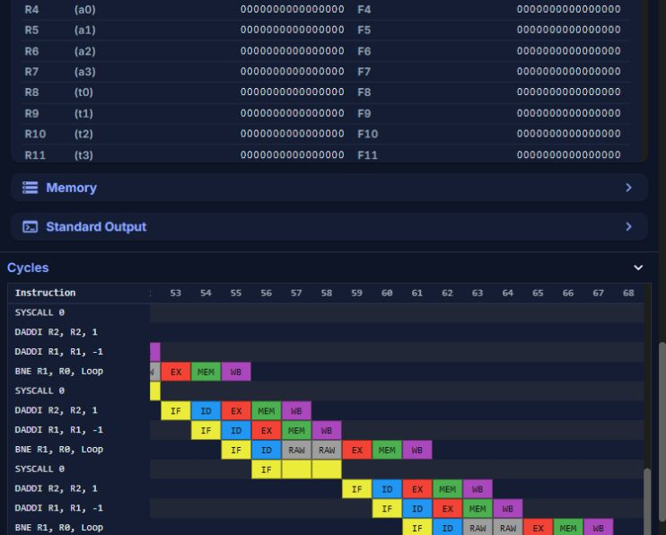

**Execução com forwarding ON:**

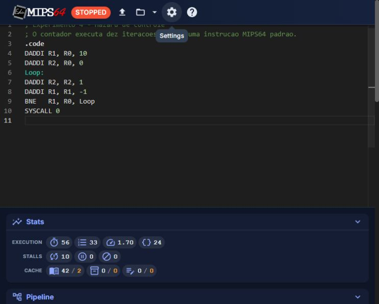

Trecho final do diagrama de ciclos (a execução completa excede a área visível).

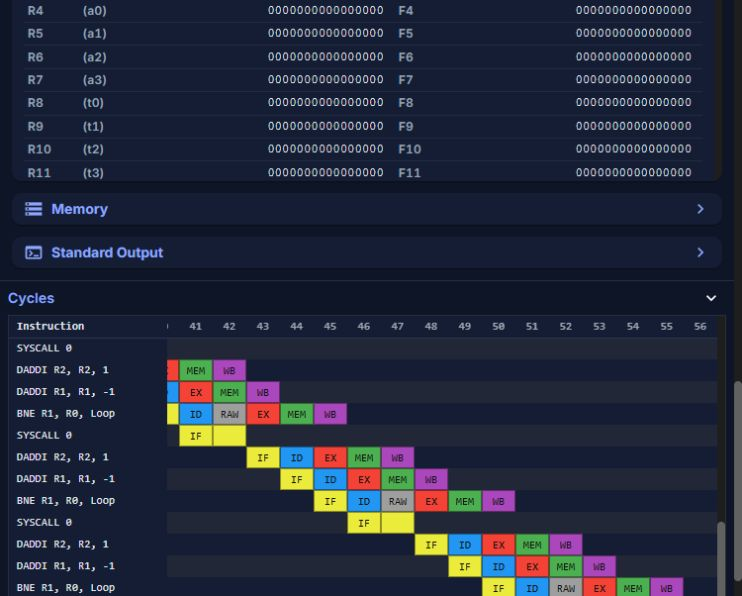

## Síntese das medições

| Experimento | Configuração | IC | CC | RAW stalls | WAW stalls | Structural stalls | CPI |
|---|---|---:|---:|---:|---:|---:|---:|
| 4.1 | OFF | 5 | 9 | 0 | 0 | 0 | 1,80 |
| 4.1 | ON | 5 | 9 | 0 | 0 | 0 | 1,80 |
| 4.2 | OFF | 5 | 15 | 6 | 0 | 0 | 3,00 |
| 4.2 | ON | 5 | 9 | 0 | 0 | 0 | 1,80 |
| 4.3 original | OFF | 4 | 12 | 4 | 0 | 0 | 3,00 |
| 4.3 original | ON | 4 | 9 | 1 | 0 | 0 | 2,25 |
| 4.3 reordenada | OFF | 5 | 12 | 3 | 0 | 0 | 2,40 |
| 4.3 reordenada | ON | 5 | 9 | 0 | 0 | 0 | 1,80 |
| 4.4 | OFF | 33 | 68 | 22 | 0 | 0 | 2,06 |
| 4.4 | ON | 33 | 56 | 10 | 0 | 0 | 1,70 |

# 5. Parte II: Programas desenvolvidos

Usamos os conceitos dos microexperimentos em três programas: soma de vetores, contagem de ocorrências e multiplicação de matrizes. Todos trabalham com inteiros de 64 bits e deixam a saída na memória. Assim, conseguimos conferir o resultado sem acrescentar rotinas de impressão à execução.

As entradas estão na seção `.data` de cada arquivo. Os três códigos foram executados até o fim com forwarding OFF e ON, mantendo Branch Delay Slot desligado. O resultado foi igual nas duas configurações. Os prints abaixo mostram a memória depois das execuções com forwarding ON.

## 5.1 Programa 1: Soma de dois vetores

**Arquivo:** [programa1_soma_vetores.s](programas/programa1_soma_vetores.s)

O programa percorre dois vetores e soma os elementos da mesma posição. Em cada volta, lê `A[i]` e `B[i]`, calcula a soma e grava em `C[i]`.

```text
A = [1, 2, 3, 4, 5]
B = [10, 20, 30, 40, 50]
N = 5

C[0] = 1 + 10 = 11
C[1] = 2 + 20 = 22
C[2] = 3 + 30 = 33
C[3] = 4 + 40 = 44
C[4] = 5 + 50 = 55

Saída esperada e observada: C = [11, 22, 33, 44, 55]
```

O trecho principal é:

```asm
LD R5, 0(R1)
LD R6, 0(R2)
DADD R7, R5, R6
SD R7, 0(R3)
```

`R1`, `R2` e `R3` guardam os endereços atuais de A, B e C. Os loads trazem os valores para `R5` e `R6`; a soma escreve em `R7`; e o store grava em C. Depois, avançamos os três endereços em oito bytes, porque cada elemento ocupa 64 bits.

`R4` começa com N e diminui uma unidade por volta. `BNE R4,R0,Loop` mantém o laço enquanto houver elementos. Um `BEQ` inicial evita entrar se N for zero. `R8` guarda o endereço da variável N durante a inicialização.

As dependências são do próprio algoritmo: a soma precisa dos loads, o store precisa da soma e o branch precisa do contador atualizado. O programa tem acesso à memória, operação aritmética, repetição, RAW e desvio condicional.

**Print da saída na memória:**

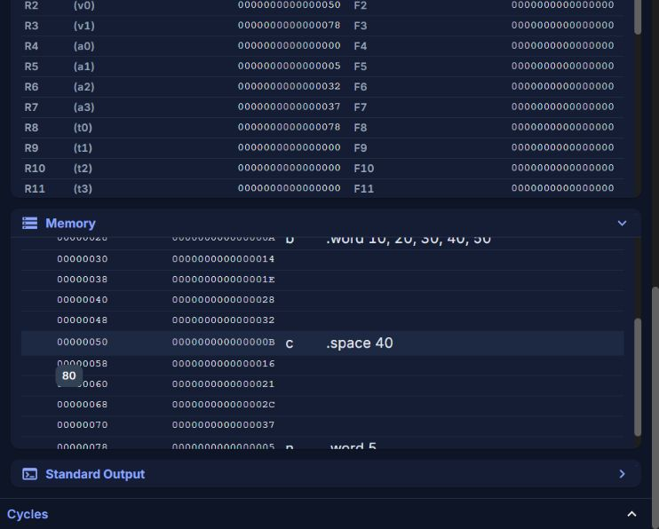

C começa em `0x50`. Os valores `0B`, `16`, `21`, `2C` e `37` são 11, 22, 33, 44 e 55 em decimal. A coluna Code mostra a reserva `.space 40`; a coluna Value mostra os dados gravados pelo programa.

## 5.2 Programa 2: Contagem de ocorrências

**Arquivo:** [programa2_contagem.s](programas/programa2_contagem.s)

O programa conta quantas vezes o alvo aparece no vetor. Em cada posição, decide se aumenta o contador ou segue sem contar.

```text
vetor = [4, 7, 4, 2, 4, 9]
alvo = 4
N = 6

O valor 4 aparece nas posições 0, 2 e 4.
Saída esperada e observada: resultado = 3
```

A decisão acontece neste trecho:

```asm
LD R5, 0(R1)
BNE R5, R3, Proximo
DADDI R6, R6, 1
```

`R3` guarda o alvo e `R5` recebe o elemento. Se forem diferentes, o desvio pula o incremento; se forem iguais, `R6` aumenta. Ao ler 7, por exemplo, não contamos. Ao ler 4, contamos uma ocorrência.

`R1` avança oito bytes por volta e `R2` conta os elementos restantes. `R4` é usado para carregar os endereços de N, alvo e resultado. No fim, gravamos `R6` em `resultado`. O teste inicial de N permite terminar com contador zero quando não há elementos.

Temos dois testes no laço: comparar o elemento com o alvo e verificar se o vetor terminou. O primeiro usa imediatamente o dado do load, formando uma RAW em `R5`. O segundo depende da atualização de `R2`. Isso permite analisar hazards de dados e de controle sem inserir dependências artificiais.

**Print da saída na memória:**

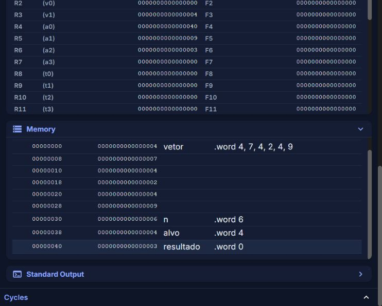

No endereço `0x40`, `resultado` ficou com 3. `R6` também mostra 3. A coluna Code mantém `.word 0`, o valor inicial do arquivo, mas Value confirma o resultado gravado pelo store.

## 5.3 Programa 3: Multiplicação de matrizes

**Arquivo:** [programa3_matrizes_original.s](programas/programa3_matrizes_original.s)

Escolhemos a multiplicação de matrizes como o programa mais completo. Ele tem três laços, calcula endereços, lê operandos, multiplica, acumula e grava a resposta. Esta é a versão original; a versão otimizada é apresentada na seção 10.

A tem duas linhas e três colunas, B tem três linhas e duas colunas e C terá duas linhas e duas colunas:

```text
A = [1  2  3]     B = [ 7   8]
    [4  5  6]         [ 9  10]
                     [11  12]

C[0][0] = 1×7 + 2×9 + 3×11   = 58
C[0][1] = 1×8 + 2×10 + 3×12  = 64
C[1][0] = 4×7 + 5×9 + 6×11   = 139
C[1][1] = 4×8 + 5×10 + 6×12  = 154

Saída esperada e observada:
C = [ 58   64]
    [139  154]
```

Guardamos as matrizes por linhas: A como `[1,2,3,4,5,6]` e B como `[7,8,9,10,11,12]`. `R1`, `R2` e `R3` guardam suas bases. `R4`, `R5` e `R6` representam i, j e k. Os rótulos `Linha`, `Coluna` e `Produto` correspondem aos três laços:

```text
para i = 0 até 1:
    para j = 0 até 1:
        soma = 0
        para k = 0 até 2:
            soma = soma + A[i][k] × B[k][j]
        C[i][j] = soma
```

Para acessar o elemento certo, usamos:

```text
endereço de A[i][k] = base de A + (i×3 + k)×8
endereço de B[k][j] = base de B + (k×2 + j)×8
endereço de C[i][j] = base de C + (i×2 + j)×8
```

O fator 8 vem do tamanho do elemento. `DSLL` com deslocamento 3 multiplica o índice por oito. `R7` e `R8` auxiliam no cálculo dos endereços; `R14` guarda 2 e `R15` guarda 3, os limites dos laços. As dimensões são fixas nesta versão: alterar só os dados não muda esses limites.

Carregamos A em `R9` e B em `R10`. O cálculo central é:

```asm
DMUL R11, R9, R10
DADD R12, R12, R11
```

`R11` recebe o produto e `R12` acumula a soma. Ao terminar os três produtos de uma posição, o store grava `R12` em C. A multiplicação é inteira, não usa os registradores F nem a unidade de ponto flutuante.

Os endereços precisam ficar prontos antes dos loads; a multiplicação precisa dos dois dados; e a soma precisa do produto. Cada branch usa um índice recém-incrementado. Esses trechos servirão para estudar forwarding e reorganização nas próximas seções.

**Print da saída na memória:**

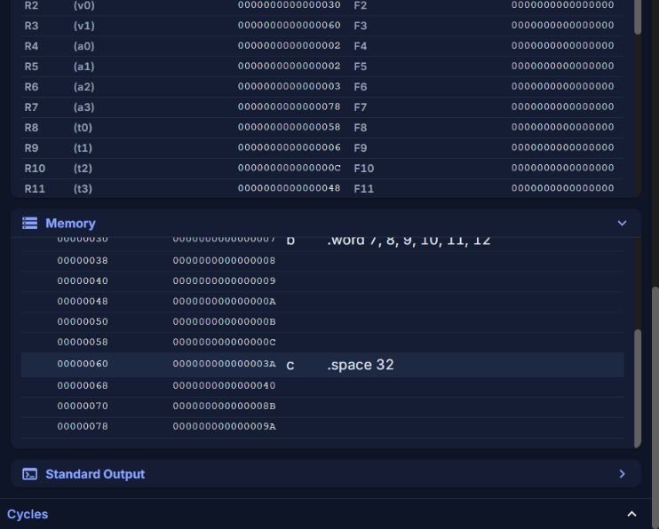

C começa em `0x60`. `3A`, `40`, `8B` e `9A` são 58, 64, 139 e 154. Os dois primeiros formam a primeira linha de C e os dois últimos formam a segunda.

## 5.4 Organização e requisitos dos códigos

Os arquivos ficam em `programas`, com `.data` para entradas e saídas e `.code` para as instruções. Os comentários explicam os registradores e os trechos principais. Os rótulos identificam os laços e os pontos de saída, e todos terminam com `SYSCALL 0`.

| Programa | Memória e cálculo | Repetição e decisão | Saída conferida |
|---|---|---|---|
| Soma de vetores | Dois loads, soma e store por posição | Contador e branch do laço | `[11,22,33,44,55]` |
| Contagem | Load e incremento do contador | Comparação com o alvo e branch do laço | `3` |
| Matrizes | Endereços, loads, produto, soma e store | Três laços com i, j e k | `[[58,64],[139,154]]` |

Todos carregaram sem erros e terminaram com a saída esperada com forwarding OFF e ON. Não inserimos NOPs para criar esperas: os hazards vêm das operações dos algoritmos. O arquivo `programa3_matrizes_original.s` foi mantido como referência; a versão otimizada fica em arquivo separado e é comparada na seção 10.

As entradas pequenas facilitam a conferência manual. Esses testes não cobrem todos os casos nem valores que provoquem overflow. Na soma e na contagem, N deve ser não negativo e não ultrapassar o espaço reservado. As matrizes têm dimensões fixas 2×3 e 3×2.

As medições dos programas estão em [medicoes_programas_auditadas.csv](resultados/tabelas/medicoes_programas_auditadas.csv), confrontadas com as capturas do painel Stats.


# 6. Validação funcional

Antes de comparar métricas de desempenho, foram verificadas as saídas dos três programas principais. As entradas são as declaradas nas respectivas seções `.data`, e a verificação foi feita pela comparação entre o resultado matematicamente esperado e os valores gravados na memória pelo EduMIPS64. A versão otimizada do Programa 3 foi testada com as mesmas entradas da versão original.

| Programa | Entrada utilizada | Saída esperada | Saída observada | Evidência |
|---|---|---|---|---|
| 1 — Soma de vetores | A = [1,2,3,4,5]; B = [10,20,30,40,50]; N = 5 | C = [11,22,33,44,55] | [11,22,33,44,55] | `resultados/imagens/programa1_on_memoria.jpg` |
| 2 — Contagem | vetor = [4,7,4,2,4,9]; alvo = 4; N = 6 | resultado = 3 | 3 | `resultados/imagens/programa2_on_memoria.jpg` |
| 3 — Matrizes original | A = [[1,2,3],[4,5,6]]; B = [[7,8],[9,10],[11,12]] | C = [[58,64],[139,154]] | [[58,64],[139,154]] | `resultados/imagens/programa3_on_memoria.jpg` |
| 3 — Matrizes otimizado | Mesmas matrizes da versão original | C = [[58,64],[139,154]] | [[58,64],[139,154]], com forwarding OFF e ON e Branch Delay Slot OFF | `resultados/imagens/programa3_otimizado_OFF_memoria.png` e transcrição da memória ON |

No Programa 3, C ocupa quatro palavras consecutivas a partir de 0x60: 3A, 40, 8B e 9A, equivalentes a 58, 64, 139 e 154. A nova execução otimizada ON confirmou esses valores no painel Memory; a captura completa está na seção 12.4. As capturas anteriores e as entradas de teste foram preservadas.

A validação funcional permite prosseguir para a análise de desempenho sem comparar saídas distintas. Para reproduzir as medições, manteve-se `Branch Delay Slot OFF`, alternando somente `Forwarding OFF/ON` entre as execuções correspondentes.

# 7. Previsão antes da simulação

## 7.1 Critérios para identificar dependências e hazards

O trecho crítico de cada programa foi examinado quanto aos registradores lidos e escritos. A dependência **RAW (Read After Write)** ocorre quando uma instrução precisa ler um valor produzido por instrução anterior. A existência de dependência não implica, por si só, um stall: a penalidade depende dos estágios em que o resultado se torna disponível, de quando será consumido e da presença de forwarding.

**Limitação metodológica:** os Programas 1, 2 e 3 original já tinham sido simulados quando esta continuação foi preparada. Para eles, a identificação abaixo é uma **análise teórica retrospectiva**, não um registro comprovadamente realizado antes das primeiras execuções. Para a versão otimizada, formulou-se uma previsão qualitativa durante a elaboração da continuação e realizou-se uma verificação funcional independente antes da nova execução no EduMIPS64; não houve previsão numérica prévia para todos os contadores de ciclos e stalls.

## 7.2 Programa 1 — Soma de vetores

Trecho crítico:

```asm
LD   R5, 0(R1)       ; I1: carrega A[i]
LD   R6, 0(R2)       ; I2: carrega B[i]
DADD R7, R5, R6      ; I3: soma os dois valores
SD   R7, 0(R3)       ; I4: grava C[i]
```

| Produtora | Consumidora | Registrador | Dependência |
|---|---|---|---|
| I1 `LD` | I3 `DADD` | R5 | RAW: primeiro operando da soma |
| I2 `LD` | I3 `DADD` | R6 | RAW: segundo operando; uso logo após load |
| I3 `DADD` | I4 `SD` | R7 | RAW: resultado gravado na memória |

A expectativa teórica é que o encaminhamento reduza a espera pelos valores, sem necessariamente eliminar toda a penalidade do segundo load, e que o branch de repetição também gere custo de controle. **Observado:** IC = 52 nas duas configurações; CC = 94 e RAW = 34 com OFF, contra CC = 72 e RAW = 12 com ON; CPI = 1,81 e 1,38, respectivamente. O ganho com forwarding foi de `94/72 = 1,31×`.

## 7.3 Programa 2 — Contagem de ocorrências

Trecho crítico:

```asm
LD    R5, 0(R1)          ; I1: lê elemento
BNE   R5, R3, Proximo    ; I2: compara com alvo
DADDI R6, R6, 1         ; I3: incrementa se igual
```

A dependência RAW de **I1→I2 em R5** é importante porque o branch usa o dado lido para decidir o fluxo. Há também dependência entre a atualização do contador de elementos em `R2` e o `BNE R2,R0,Loop` no fim do laço. A expectativa teórica é haver redução dos stalls com forwarding, mas persistirem esperas associadas à leitura de memória e ao controle.

**Observado:** IC = 43 em ambos os casos; CC = 85 e RAW = 30 com OFF, contra CC = 73 e RAW = 18 com ON; CPI = 1,98 e 1,70, respectivamente. O ganho com forwarding foi de `85/73 = 1,16×`.

## 7.4 Programa 3 — Multiplicação de matrizes: original e otimizado

Na versão original, o laço `Produto` recalcula endereços de A e B para cada multiplicação, usando operações aritméticas e deslocamentos antes dos loads. O trecho de consumo de operandos é:

```asm
LD   R9, 0(R7)         ; carrega A[i][k]
LD   R10, 0(R8)        ; carrega B[k][j]
DMUL R11, R9, R10      ; depende dos dois loads
DADD R12, R12, R11     ; depende da multiplicação
```

Existem dependências RAW **LD→DMUL em R9/R10** e **DMUL→DADD em R11**. Há ainda dependências de endereço e entre incrementos dos índices e desvios condicionais. O objetivo da versão otimizada foi reduzir cálculos redundantes de endereços e colocar trabalho útil entre as instruções produtoras e consumidoras.

O laço otimizado executa:

```asm
Produto:
    LD    R9, 0(R7)          ; I1
    LD    R10, 0(R8)         ; I2
    DADDI R7, R7, 8         ; I3
    DADDI R8, R8, 16        ; I4
    DMUL  R11, R9, R10      ; I5
    DADDI R6, R6, 1         ; I6
    DADD  R12, R12, R11     ; I7
    BNE   R6, R15, Produto  ; I8
```

**Previsão qualitativa:** as instruções I3 e I4, que atualizam os ponteiros para leituras futuras, ocupam o intervalo entre os loads e o uso em I5; I6 ocupa o intervalo entre multiplicação e acumulação. Isso tende a diminuir as esperas RAW, sobretudo com forwarding, embora os desvios do laço permaneçam necessários. O resultado matemático deveria permanecer C = [[58,64],[139,154]]. A contagem independente de instruções da nova implementação indicou 151 instruções dinâmicas, valor posteriormente confirmado no simulador.

| Métrica | Original OFF | Otimizado OFF | Original ON | Otimizado ON |
|---|---:|---:|---:|---:|
| IC | 217 | 151 | 217 | 151 |
| CC | 540 | 214 | 262 | 172 |
| RAW stalls | 308 | 48 | 30 | 6 |
| WAW stalls | 0 | 0 | 0 | 0 |
| Structural stalls | 0 | 0 | 0 | 0 |
| CPI | 2,49 | 1,42 | 1,21 | 1,14 |

**Diferença entre a hipótese e o observado:** o sentido da melhoria foi confirmado, mas as quantidades exatas de ciclos e stalls não haviam sido previstas. A redução da versão original para a otimizada foi de 540 para 214 ciclos com OFF (speedup = **2,52×**) e de 262 para 172 com ON (speedup = **1,52×**). A versão otimizada manteve o resultado correto com ambos os estados de forwarding, desde que `Branch Delay Slot` estivesse desabilitado. Ao habilitar essa última opção, a execução de instruções situadas após branches afetou o fluxo de controle; por isso, esse cenário não é comparado com as medições principais.

Nos prints do EduMIPS64 Web, o painel Stats apresentou os contadores **RAW, WAW e structural stalls**, mas não um contador independente de branch stalls. Assim, eventuais penalidades líquidas de controle devem ser identificadas como **inferência**, não como medição direta.

# 8. Análise detalhada do pipeline

## 8.1 Escolha do trecho e configuração

O trecho analisado contém as oito instruções consecutivas **I1–I8** do laço `Produto` do Programa 3 otimizado, apresentadas na seção 7.4. Foi usada a execução com **Forwarding ON**, **Branch Delay Slot OFF**, 151 instruções dinâmicas, 172 ciclos e seis stalls RAW no programa completo. As figuras abaixo mostram a **primeira iteração** do trecho em dois recortes do painel Cycles.

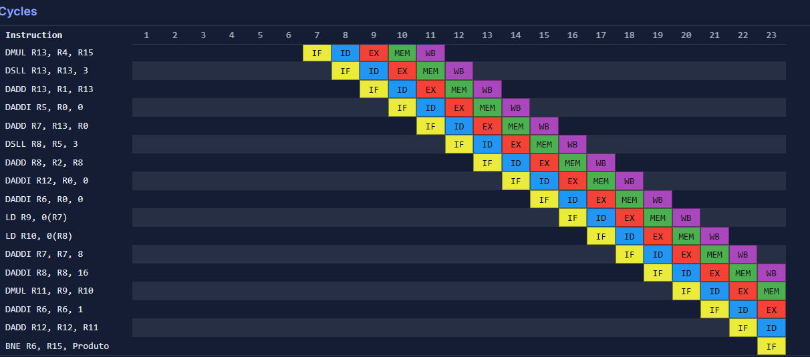

*Figura 8.1 — Entrada do laço Produto no pipeline, com a primeira busca da instrução I1 no ciclo 16.*

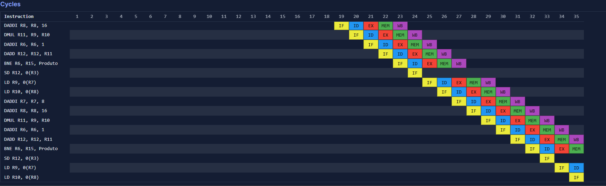

*Figura 8.2 — Conclusão do trecho, desvio tomado e início da próxima iteração.*

## 8.2 Ocupação dos estágios IF, ID, EX, MEM e WB

| Instrução | IF | ID | EX | MEM | WB |
|---|---:|---:|---:|---:|---:|
| I1 `LD R9,0(R7)` | 16 | 17 | 18 | 19 | 20 |
| I2 `LD R10,0(R8)` | 17 | 18 | 19 | 20 | 21 |
| I3 `DADDI R7,R7,8` | 18 | 19 | 20 | 21 | 22 |
| I4 `DADDI R8,R8,16` | 19 | 20 | 21 | 22 | 23 |
| I5 `DMUL R11,R9,R10` | 20 | 21 | 22 | 23 | 24 |
| I6 `DADDI R6,R6,1` | 21 | 22 | 23 | 24 | 25 |
| I7 `DADD R12,R12,R11` | 22 | 23 | 24 | 25 | 26 |
| I8 `BNE R6,R15,Produto` | 23 | 24 | 25 | 26 | 27 |

Tabela ciclo a ciclo (célula vazia significa que a instrução ainda não entrou ou já saiu do pipeline):

| Ciclo | I1 | I2 | I3 | I4 | I5 | I6 | I7 | I8 |
|---:|---|---|---|---|---|---|---|---|
| 16 | IF | | | | | | | |
| 17 | ID | IF | | | | | | |
| 18 | EX | ID | IF | | | | | |
| 19 | MEM | EX | ID | IF | | | | |
| 20 | WB | MEM | EX | ID | IF | | | |
| 21 | | WB | MEM | EX | ID | IF | | |
| 22 | | | WB | MEM | EX | ID | IF | |
| 23 | | | | WB | MEM | EX | ID | IF |
| 24 | | | | | WB | MEM | EX | ID |
| 25 | | | | | | WB | MEM | EX |
| 26 | | | | | | | WB | MEM |
| 27 | | | | | | | | WB |

A tabela foi transcrita das figuras 8.1 e 8.2. Não foram observadas células `RAW` nem bolhas de dados **nessa primeira ocorrência específica das oito instruções**. Isso **não contradiz** os seis stalls RAW registrados pelo painel Stats na execução completa; essas esperas aparecem em outros pontos ou iterações do programa.

## 8.3 Dependências, forwarding e bolhas

1. **I1→I5 em R9 e I2→I5 em R10 (RAW):** os operandos são carregados pelos dois `LD`, mas as instruções I3 e I4 executam atualizações úteis de ponteiros antes da multiplicação. Na captura, I1 está em MEM no ciclo 19 e I2 em MEM no ciclo 20; I5 só chega a EX no ciclo 22. O resultado de memória está disponível a tempo, sem stall RAW visível entre os loads e a multiplicação nesse trecho.
2. **I5→I7 em R11 (RAW):** a multiplicação está em EX no ciclo 22, enquanto I7 só chega a EX no ciclo 24. A instrução I6, independente do produto, foi colocada entre elas, criando o intervalo que permite aproveitar o valor produzido com forwarding, sem bolha visível nessa primeira ocorrência.
3. **I6→I8 em R6 (RAW):** o branch precisa do índice `k` atualizado. I6 passa por EX no ciclo 23; I8 está em ID no ciclo 24 e EX no ciclo 25. A captura mostra avanço sem marcação RAW nesse ponto específico.

**Controle:** na figura 8.2, a instrução sequencial `SD R12,0(R3)` aparece em **IF no ciclo 24**, mas não prossegue para os demais estágios quando o desvio é tomado. O `LD R9,0(R7)` da próxima iteração começa a ser buscado no **ciclo 25**, evidenciando o redirecionamento do fluxo. A penalidade de controle não deve ser confundida com um stall RAW. Essa observação corresponde à iteração capturada e não substitui a contagem global dos desvios.

As medições do programa otimizado foram **151 instruções, 214 ciclos e 48 stalls RAW com forwarding OFF**, e **151 instruções, 172 ciclos e seis stalls RAW com forwarding ON**. Logo, os 42 ciclos a menos com ON coincidiram com a redução de 42 stalls RAW. Um cálculo residual, sob o modelo `IC+4` usado anteriormente e sem outros tipos de stall contados, dá `CC−IC−4−RAW = 11` ciclos em ambos os casos; esse valor é uma **estimativa líquida de controle**, e não um contador exibido em Stats.

# 9. Grafo de dependências

O grafo da figura 9.1 foi construído a partir do mesmo trecho I1–I8 estudado na seção 8. As **setas contínuas** são dependências RAW verdadeiras dentro da iteração; as **setas pontilhadas** registram restrições WAR de leitura antes de atualização de ponteiros; as **setas tracejadas** representam dependências RAW transportadas para a iteração seguinte.

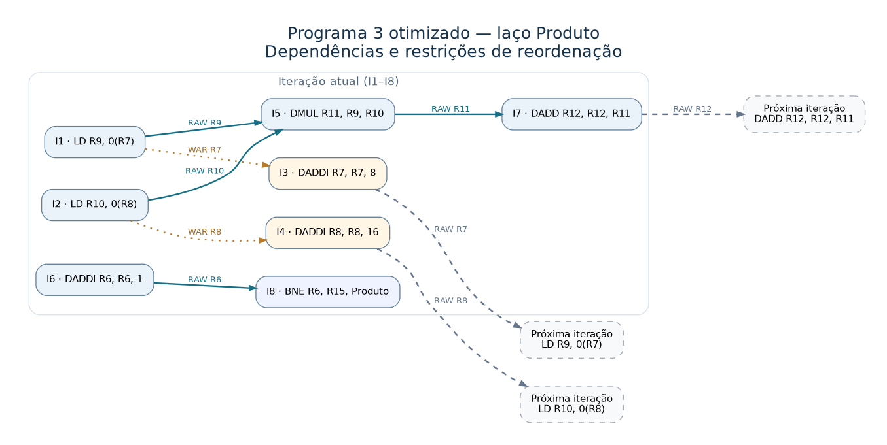

*Figura 9.1 — Dependências do trecho crítico do Programa 3 otimizado. Fonte editável em `resultados/imagens/grafo_dependencias_programa3.dot`.*

## 9.1 Dependências verdadeiras

- **I1→I5 (R9):** a multiplicação consome o valor carregado de A.
- **I2→I5 (R10):** a multiplicação consome o valor carregado de B.
- **I5→I7 (R11):** a soma acumulada consome o produto da multiplicação.
- **I6→I8 (R6):** o desvio consome o índice `k` incrementado.
- **Entre iterações:** a atualização de R7 em I3 alimenta a leitura de A no próximo I1; a atualização de R8 em I4 alimenta a próxima leitura de B no próximo I2; e o acumulador escrito por I7 alimenta a próxima execução de I7 enquanto o laço continua.

## 9.2 Independência e oportunidade de ILP

I3 e I4 não precisam dos **valores carregados** por I1 e I2: seus operandos são os ponteiros R7 e R8. Por isso, podem ocupar o intervalo até I5 precisar dos resultados dos loads. De modo semelhante, I6 não precisa do produto produzido por I5 e pode ser executada antes de I7. Essa distribuição de instruções independentes ajuda a sobrepor diferentes estágios e a evitar esperas, explorando paralelismo em nível de instrução (ILP) por **escalonamento de instruções**.

**Restrição de semântica:** isso não significa que todas essas instruções possam trocar de posição livremente. I1 precisa ler o endereço antigo de R7 antes de I3 modificá-lo, e I2 precisa ler o endereço antigo de R8 antes de I4 modificá-lo. O grafo identifica essas restrições de ordenação **WAR (antidependências)**; elas não foram observadas como stalls WAR no simulador, mas precisam ser preservadas numa possível nova reorganização. A soma também deve preservar o encadeamento do acumulador R12 entre as iterações. Mudar essas ordens poderia alterar os elementos multiplicados e, portanto, a matriz final.

Conclui-se que a otimização não eliminou as dependências necessárias do algoritmo; ela reduziu o recálculo de endereços e posicionou operações independentes entre as dependências RAW. Em consequência, as medições registraram menor contagem de instruções e menos stalls, preservando a saída funcional.

# 10. Otimização por reordenação de instruções

## 10.1 Objetivo e condições de comparação

Conforme exigido no enunciado, o **Programa 3 — multiplicação de matrizes** foi implementado em duas versões: [original](programas/programa3_matrizes_original.s) e [otimizada](programas/programa3_matrizes_otimizado.s). A otimização manteve o mesmo algoritmo de multiplicação, as mesmas entradas e dimensões (**A com 2×3, B com 3×2 e C com 2×2**), alterando apenas a forma de calcular os endereços e de organizar instruções independentes. Portanto, a comparação não decorre de modificar o problema ou reduzir artificialmente o trabalho matemático: ambas as versões realizam as mesmas **12 multiplicações e acumulações** necessárias para os quatro elementos de C.

Os testes foram realizados no **EduMIPS64 Web**, sempre com **Branch Delay Slot desabilitado**, nas duas configurações: **Forwarding OFF** e **Forwarding ON**. Entre versões comparadas, mantiveram-se os dados de entrada e os demais ajustes experimentais usados nas seções anteriores. As métricas IC, CC, RAW, WAW e structural stalls foram extraídas do painel **Stats**; o CPI foi obtido pela divisão de CC por IC. O painel utilizado **não exibiu um contador separado de branch stalls**, razão pela qual essa métrica é indicada como **não disponível**, sem substituí-la silenciosamente por zero.

## 10.2 Transformações efetuadas no código

A versão original recalculava, em cada iteração interna `k`, os endereços de `A[i][k]` e `B[k][j]`, combinando multiplicação de índices, deslocamentos e adições. O trecho original incluía:

```asm
Produto:
    DMUL R7, R4, R15   ; i*3
    DADD R7, R7, R6    ; i*3 + k
    DSLL R7, R7, 3     ; indice em bytes
    DADD R7, R1, R7    ; endereco de A[i][k]
    LD   R9, 0(R7)
    DSLL R8, R6, 1     ; k*2
    DADD R8, R8, R5    ; k*2 + j
    DSLL R8, R8, 3
    DADD R8, R2, R8    ; endereco de B[k][j]
    LD   R10, 0(R8)
    DMUL R11, R9, R10
    DADD R12, R12, R11
    DADDI R6, R6, 1
    BNE R6, R15, Produto
```

Na versão otimizada, o início da linha de A é calculado **uma vez por linha** e mantido em `R13`; no início de cada coluna `j`, `R7` recebe essa base. A posição inicial de B é calculada para a coluna atual, e os dois ponteiros são incrementados dentro do laço: **R7 += 8 bytes** (próximo elemento da mesma linha de A) e **R8 += 16 bytes** (próxima linha de B, que tem duas colunas de 8 bytes). O ponteiro da saída C (`R3`) também é incrementado em oito bytes após cada gravação, evitando novo cálculo do índice de C.

O novo laço central ficou:

```asm
Produto:
    LD    R9, 0(R7)           ; carrega A[i][k]
    LD    R10, 0(R8)          ; carrega B[k][j]
    DADDI R7, R7, 8          ; prepara proximo endereco de A
    DADDI R8, R8, 16         ; prepara proximo endereco de B
    DMUL  R11, R9, R10       ; multiplica os dois dados lidos
    DADDI R6, R6, 1          ; avanca k sem depender do produto
    DADD  R12, R12, R11      ; acumula a multiplicacao
    BNE   R6, R15, Produto   ; repete ate k = 3
```

As instruções de incremento de R7 e R8 são **independentes dos valores carregados** em R9 e R10, embora devam permanecer **depois dos respectivos loads**, pois a leitura precisa utilizar o endereço antigo. Elas preenchem parte do intervalo antes do consumo pela `DMUL`. O incremento de R6 foi posicionado entre a `DMUL` e a `DADD`, que consome seu resultado. Essas escolhas exploram **paralelismo em nível de instrução (ILP)** sem violar as dependências RAW e as restrições de reordenação descritas na seção 9.

As mudanças são, portanto, uma combinação de **reorganização de instruções independentes, redução de recálculo de endereços, eliminação de operações redundantes e utilização de ponteiros/registradores**. Não houve alteração de entradas, dimensão das matrizes ou resultado desejado.

## 10.3 Verificação da equivalência funcional

Nas quatro execuções comparadas (original OFF/ON e otimizada OFF/ON), a matriz resultado foi:

`C = [[58, 64], [139, 154]]`

O resultado é verificável no painel Memory em 0x60, 0x68, 0x70 e 0x78: 3A, 40, 8B e 9A. A captura otimizada OFF anterior foi preservada; a nova captura real otimizada ON, na seção 12.4, mostra toda a região C e o Stats da mesma execução.

A equivalência foi verificada para a **entrada de teste utilizada**, não para todas as dimensões ou valores possíveis. Tanto a versão original quanto a otimizada usam dimensões fixas 2×3 e 3×2.


*Figura 10.1 — Resultado da multiplicação na versão original (valores em hexadecimal).* 

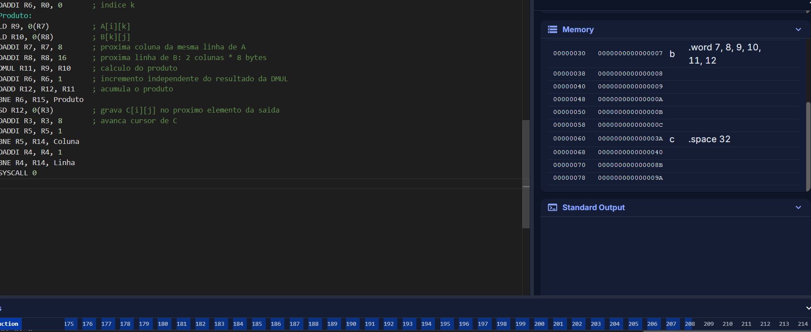

*Figura 10.2 — Resultado idêntico na versão otimizada.*

### 10.3.1 Consolidação das evidências disponíveis (Web)

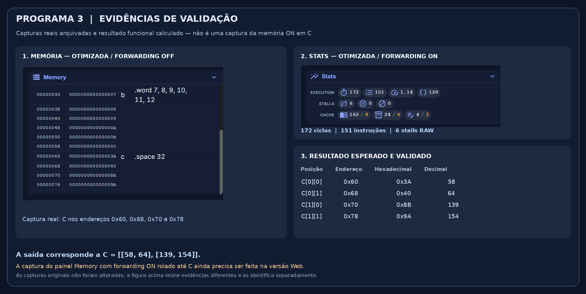

**Leitura correta da figura:** a captura do lado esquerdo é a **execução otimizada OFF** e mostra `C=(0x3A, 0x40, 0x8B, 0x9A)` nos endereços `0x60..0x78`. A captura superior à direita é o **Stats da execução otimizada ON**, com 151 instruções, 172 ciclos e 6 stalls RAW. A tabela inferior à direita é uma **transcrição validada da saída esperada**, e **não um print do painel Memory ON**. A imagem incompleta da memória ON original permanece preservada no repositório.

O painel composto acima é um registro histórico. A pendência visual ON foi resolvida pela nova captura real da seção 12.4, com todos os elementos de C e os contadores Stats da mesma execução.

## 10.4 Comparação quantitativa

A Tabela 10.1 reúne as quatro medições completas e verificadas no EduMIPS64. **Branch stalls** não foi exibido separadamente no painel usado; por isso a coluna está identificada como `N/D` (não disponível), e não como zero.

| Versão | Forwarding | IC | CC | RAW stalls | WAW stalls | Structural stalls | Branch stalls (painel) | CPI |
|---|---|---:|---:|---:|---:|---:|---|---:|
| Original | OFF | 217 | 540 | 308 | 0 | 0 | N/D | 2,49 |
| Original | ON | 217 | 262 | 30 | 0 | 0 | N/D | 1,21 |
| Otimizada | OFF | 151 | 214 | 48 | 0 | 0 | N/D | 1,42 |
| Otimizada | ON | 151 | 172 | 6 | 0 | 0 | N/D | 1,14 |

*Tabela 10.1 — Comparação medida nas mesmas condições de entrada. Os valores arredondados de CPI foram calculados como CC/IC; medições completas encontram-se em `resultados/tabelas/medicoes_programas_auditadas.csv` e em `resultados/tabelas/comparacao_programa3_secao10.csv`.*

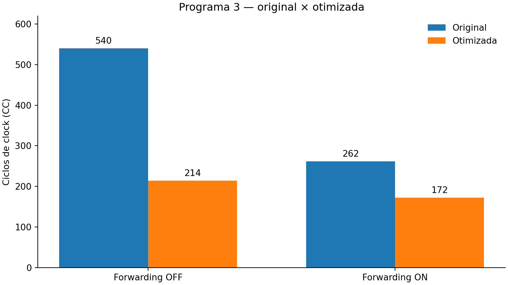

*Figura 10.3 — Ciclos da versão original e da otimizada, com forwarding OFF e ON.*

A redução no número de instruções executadas, comum às duas configurações de forwarding, foi de **217 para 151**, isto é, **66 instruções a menos**, ou **30,4%**. Essa redução decorre principalmente da substituição de cálculos repetitivos de endereços por atualizações de ponteiros.

O ganho de desempenho é calculado em ciclos, assumindo o mesmo período de clock em cada comparação:

`Speedup_OFF = 540 / 214 ≈ 2,52×`

`Speedup_ON = 262 / 172 ≈ 1,52×`

| Configuração | Ciclos original → otimizada | Redução de CC | RAW stalls original → otimizada | Redução de RAW | Speedup |
|---|---|---:|---|---:|---:|
| Forwarding OFF | 540 → 214 | **60,4%** | 308 → 48 | **84,4%** | **2,52×** |
| Forwarding ON | 262 → 172 | **34,4%** | 30 → 6 | **80,0%** | **1,52×** |

*Tabela 10.2 — Ganhos da otimização mantendo fixo o estado do forwarding.*

O CPI diminuiu de **2,49 para 1,42** sem forwarding e de **1,21 para 1,14** com forwarding. Entretanto, o CPI isoladamente não caracteriza todo o ganho, pois tanto o número de instruções (IC) quanto o número de ciclos (CC) mudaram. Por isso, o speedup é calculado pelos ciclos, não pela razão dos CPIs.

## 10.5 Interpretação dos stalls e dos desvios

A versão original possui uma cadeia maior de operações de cálculo de endereços dentro do laço, criando dependências entre valores de índices, deslocamentos, endereços, loads, multiplicação e soma. A versão otimizada evita várias dessas operações a cada iteração e intercala instruções que não dependem dos operandos da multiplicação. Essa diferença explica a diminuição simultânea de **IC** e **RAW stalls**.

Dentro das condições deste experimento, a comparação dos ciclos também é consistente com a seguinte decomposição do modelo de cinco estágios apresentado na seção 3:

`CC = (IC + 4) + stalls RAW + penalidade líquida de controle`

| Execução | Cálculo do resíduo de controle | Resíduo inferido |
|---|---|---:|
| Original OFF | 540 − (217 + 4) − 308 | 11 ciclos |
| Original ON | 262 − (217 + 4) − 30 | 11 ciclos |
| Otimizada OFF | 214 − (151 + 4) − 48 | 11 ciclos |
| Otimizada ON | 172 − (151 + 4) − 6 | 11 ciclos |

Esses **11 ciclos são uma penalidade líquida de controle inferida**, **não um valor lido de um contador de branch stalls**. No caso estudado, o resultado é compatível com 11 desvios tomados nos laços aninhados, mantendo-se a mesma sequência funcional de controle nas duas versões. A inferência depende das hipóteses sobre o pipeline e sobre quais esperas já estão incluídas nos contadores; não deve ser tratada como fórmula universal de processadores MIPS64.

Essa decomposição ajuda a explicar os ganhos de forma concreta. Com forwarding OFF, a diferença total de **326 ciclos** entre original e otimizada corresponde aos **66 comandos a menos e 260 stalls RAW a menos**; com forwarding ON, os **90 ciclos** de redução correspondem a **66 instruções e 24 stalls RAW** eliminados. O restante inferido associado ao controle manteve-se constante. O valor global de RAW stalls, portanto, é indispensável para explicar o desempenho — não basta afirmar genericamente que o código “ficou mais rápido”.

## 10.6 Síntese da otimização

O Programa 3 otimizado preservou a saída C = [[58,64],[139,154]] para a entrada testada e reduziu o custo de execução em ambas as configurações. A otimização explorou duas oportunidades complementares: **reduzir trabalho redundante** (sobretudo cálculos de endereços) e **preencher intervalos de dependência com trabalho útil** (incrementos de ponteiros e do índice `k`). Isso reduziu o número de instruções de 217 para 151, diminuiu os stalls RAW e produziu **speedup de 2,52× com forwarding OFF e 1,52× com forwarding ON**, sem modificar o problema matemático.

Com isso, a etapa de otimização da seção 10 está concluída para o caso de teste medido. A análise consolidada aparece na seção 11; a seção 12 distingue medições existentes de previsões para outras entradas; e as seções 13 e 14 apresentam a discussão e a reprodução.

**Evidências da comparação:**

- Original OFF: 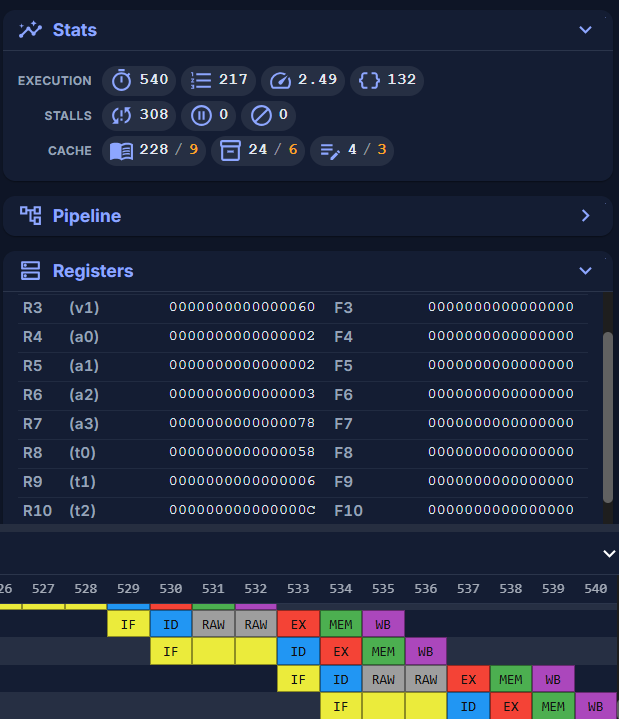
- Original ON: 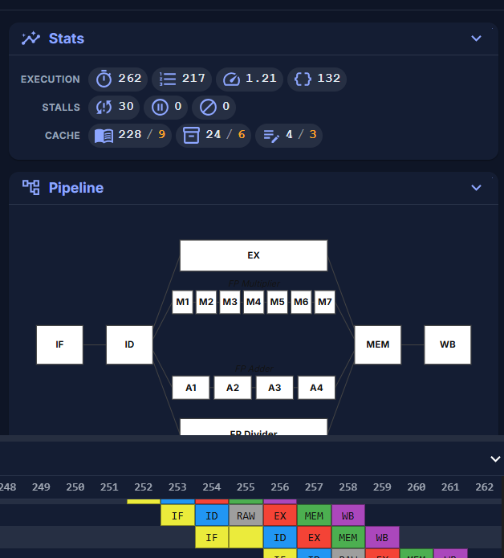
- Otimizada OFF: 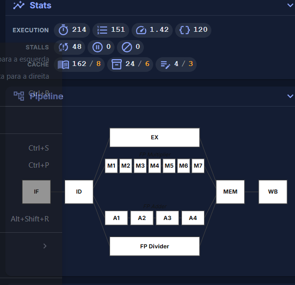
- Otimizada ON: 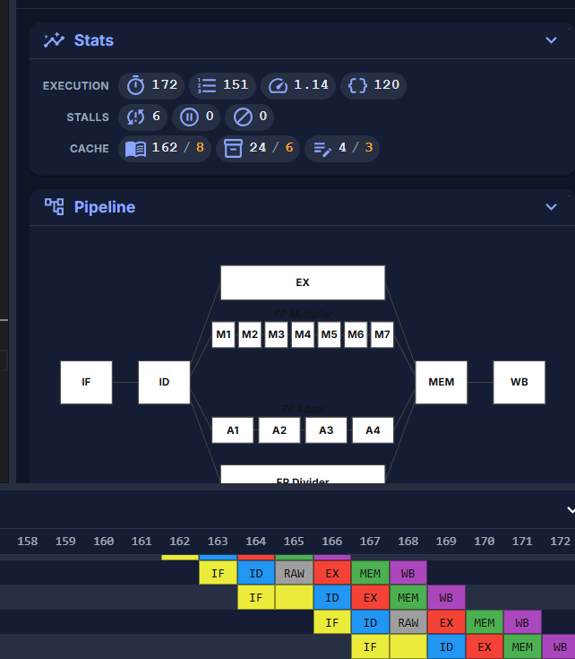


# 11. Análise quantitativa de desempenho

As métricas a seguir são as capturas realizadas no EduMIPS64 Web e registradas nas seções 4–10, consolidadas no arquivo [`resumo_desempenho_secao11.csv`](resultados/tabelas/resumo_desempenho_secao11.csv). Adotamos **IC = instruções dinâmicas executadas**, incluindo `SYSCALL 0`; **CC = ciclos de relógio da simulação**; **CPI = CC/IC**. O tempo real de execução do navegador não é utilizado. O **speedup**, quando comparados códigos com mesmo período de clock, é `CC_referência/CC_comparada`.

**Atenção à terminologia:** o painel Stats das capturas mostra stalls RAW, WAW e estruturais, mas **não exibe branch stalls como coluna independente**. Nas tabelas, branch stalls **medidos** são `N/D`. Um número obtido por `CC − (IC + 4) − RAW`, sob as hipóteses de pipeline de cinco estágios sem outras penalidades, é rotulado separadamente como **resíduo líquido de controle inferido**, não como leitura direta do simulador. Isso evita inventar uma métrica.

## 11.1 Microexperimentos: medições existentes

| Experimento | Forwarding | IC | CC | Data stalls (RAW) | Branch stalls (painel) | Resíduo de controle inferido | CPI |
|---|---|---:|---:|---:|---|---:|---:|
| 4.1 Pipeline ideal | OFF | 5 | 9 | 0 | N/D | 0 | 1,80 |
| 4.1 Pipeline ideal | ON | 5 | 9 | 0 | N/D | 0 | 1,80 |
| 4.2 RAW | OFF | 5 | 15 | 6 | N/D | 0 | 3,00 |
| 4.2 RAW | ON | 5 | 9 | 0 | N/D | 0 | 1,80 |
| 4.3 Load-use original | OFF | 4 | 12 | 4 | N/D | 0 | 3,00 |
| 4.3 Load-use original | ON | 4 | 9 | 1 | N/D | 0 | 2,25 |
| 4.3 Load-use reordenado | OFF | 5 | 12 | 3 | N/D | 0 | 2,40 |
| 4.3 Load-use reordenado | ON | 5 | 9 | 0 | N/D | 0 | 1,80 |
| 4.4 Desvio | OFF | 33 | 68 | 22 | N/D | 9 | 2,06 |
| 4.4 Desvio | ON | 33 | 56 | 10 | N/D | 9 | 1,70 |

O experimento sem dependências não apresentou diferença entre OFF e ON (9 ciclos). No experimento de cadeia RAW, o forwarding reduziu os stalls de 6 para 0 e o CC de 15 para 9 (speedup **1,67×**). O caso load-use original caiu de 12 para 9 ciclos com forwarding (**1,33×**), mas conservou **1 stall RAW** mesmo com ON; com instrução independente, os 9 ciclos de ON permaneceram iguais, pois entrou uma instrução adicional no lugar da bolha. No desvio, o forwarding reduziu RAW de 22 para 10, mas o resíduo de controle ficou em 9 ciclos: o ganho foi **1,21×** (68/56).

## 11.2 Programas principais: medições existentes

| Programa | Versão | Forwarding | IC | CC | Data stalls (RAW) | Branch stalls (painel) | Controle inferido | CPI |
|---|---|---|---:|---:|---:|---|---:|---:|
| P1 Soma de vetores | Original | OFF | 52 | 94 | 34 | N/D | 4 | 1,81 |
| P1 Soma de vetores | Original | ON | 52 | 72 | 12 | N/D | 4 | 1,38 |
| P2 Contagem | Original | OFF | 43 | 85 | 30 | N/D | 8 | 1,98 |
| P2 Contagem | Original | ON | 43 | 73 | 18 | N/D | 8 | 1,70 |
| P3 Matrizes | Original | OFF | 217 | 540 | 308 | N/D | 11 | 2,49 |
| P3 Matrizes | Original | ON | 217 | 262 | 30 | N/D | 11 | 1,21 |
| P3 Matrizes | Otimizada | OFF | 151 | 214 | 48 | N/D | 11 | 1,42 |
| P3 Matrizes | Otimizada | ON | 151 | 172 | 6 | N/D | 11 | 1,14 |

Nas capturas, as contagens de WAW e structural stalls foram zero em todas as execuções acima. O resíduo inferido foi calculado como `CC − IC − 4 − RAW`: 4 no Programa 1, 8 no Programa 2 e 11 no Programa 3. Os resultados são consistentes com o custo líquido do controle nesses testes; **não** demonstram que o simulador tenha medido exatamente esse número de branch stalls. Não é correto somar automaticamente esse resíduo a uma futura coluna de branch stalls medida sem verificar as definições.

## 11.3 Comparações, speedups e interpretação

| Comparação | CC referência → CC nova | Redução de CC | RAW referência → RAW nova | Speedup |
|---|---|---:|---|---:|
| P1: OFF → ON | 94 → 72 | 23,40% | 34 → 12 | 1,31× |
| P2: OFF → ON | 85 → 73 | 14,12% | 30 → 18 | 1,16× |
| P3 original: OFF → ON | 540 → 262 | 51,48% | 308 → 30 | 2,06× |
| P3 otimizada: OFF → ON | 214 → 172 | 19,63% | 48 → 6 | 1,24× |
| P3 com OFF: original → otimizada | 540 → 214 | 60,37% | 308 → 48 | 2,52× |
| P3 com ON: original → otimizada | 262 → 172 | 34,35% | 30 → 6 | 1,52× |
| P3 original OFF → otimizada ON (mudam dois fatores) | 540 → 172 | 68,15% | 308 → 6 | 3,14× |

O maior ganho isolado por **forwarding** ocorreu no Programa 3 original (540/262 ≈ **2,06×**). A otimização do Programa 3 reduziu IC de 217 para 151 e, em forwarding OFF, diminuiu RAW de 308 para 48. A versão otimizada com forwarding ON foi a execução mais rápida desse programa, com 172 ciclos; sua comparação com a original OFF (**3,14×**) é uma combinação de **otimização de código e mudança de hardware simulado**, e não deve ser atribuída só a uma delas.

Para qualquer comparação de versões que altera IC, **não** se deve calcular o speedup apenas pela divisão dos CPIs; usa-se o número de ciclos. Em todos os pares acima, presumimos período de clock idêntico, sem inferir frequência nem tempo real.

# 12. Experimento com diferentes tamanhos de entrada

O Programa 1 soma vetores de N = 5, 10, 20 e 50 elementos de 64 bits, com A[i] = i+1 e B[i] = 10(i+1). O resultado esperado é C[i] = 11(i+1).

### 12.1 Procedimento e configuração

Os arquivos programa1_n10.s, programa1_n20.s e programa1_n50.s foram executados no https://web.edumips.org/ com forwarding OFF e ON, usando Load e Run All até STOPPED. As seis medições abaixo foram lidas do Stats real, não calculadas por um interpretador. N=5 preserva as medições anteriores.

Build observado em Help > About: **1.4.0-223-gce45a8d9**, production. Coleta desta revisão: 23/10/2026. Mantiveram-se Branch Delay Slot OFF; caches L1 de instruções e dados: 1024 bytes, bloco 16 bytes e associatividade 1. A única opção de simulação alternada foi CPU Forwarding. O identificador do build das capturas anteriores continua desconhecido.

### 12.2 Medições reais

| N | Forwarding | IC | CC | RAW | WAW | Estruturais | CPI |
|---:|---|---:|---:|---:|---:|---:|---:|
| 5 | OFF | 52 | 94 | 34 | 0 | 0 | 1.81 |
| 5 | ON | 52 | 72 | 12 | 0 | 0 | 1.38 |
| 10 | OFF | 97 | 174 | 64 | 0 | 0 | 1.79 |
| 10 | ON | 97 | 132 | 22 | 0 | 0 | 1.36 |
| 20 | OFF | 187 | 334 | 124 | 0 | 0 | 1.79 |
| 20 | ON | 187 | 252 | 42 | 0 | 0 | 1.35 |
| 50 | OFF | 457 | 814 | 304 | 0 | 0 | 1.78 |
| 50 | ON | 457 | 612 | 102 | 0 | 0 | 1.34 |

CPI = CC/IC, arredondado a duas casas. Branch stalls: N/D; o painel não exibe contador separado. Os dados e a proveniência estão em resultados/tabelas/medicoes_tamanho_secao12.csv. As seis capturas integrais estão em resultados/imagens/n10_OFF.jpg, n10_ON.jpg, n20_OFF.jpg, n20_ON.jpg, n50_OFF.jpg e n50_ON.jpg.

### 12.3 Análise de escala

As contagens observadas confirmam IC = 7 + 9N: seis instruções iniciais, nove por iteração e SYSCALL 0. As seis medições coincidiram com as projeções anteriores, preservadas em projecoes_tamanho_secao12.csv para comparação histórica.

Na série medida, CC_OFF = 14 + 16N e RAW_OFF = 4 + 6N; CC_ON = 12 + 12N e RAW_ON = 2 + 2N. O forwarding reduziu ciclos em 24,1% (N=10), 24,6% (N=20) e 24,8% (N=50); os speedups foram 1,318, 1,325 e 1,330. IC permaneceu igual entre OFF e ON.

O CPI OFF variou de 1,79 a 1,78, enquanto ON caiu de 1,36 a 1,34. O custo fixo perde importância e o crescimento observado é linear. Isso é compatível com limites de 16/9 e 12/9 para este modelo, sem provar o comportamento de qualquer entrada maior.

O resíduo CC - IC - 4 - RAW foi 9, 19 e 49 para N=10,20,50, respectivamente. É uma inferência compatível com N-1 desvios tomados, não uma medida de branch stalls. Para N=50, os três vetores ocupam 1200 bytes; o Stats mostrou 51 misses em 101 leituras e 25 misses em 50 escritas de dados, em ambos os estados. Ainda assim, os ciclos coincidiram com a projeção: não se atribui uma penalidade adicional de ciclos a esses misses sem evidência.

### 12.4 Evidência complementar: Programa 3 otimizado ON

O arquivo programa3_matrizes_otimizado.s foi executado com Forwarding ON e Branch Delay Slot OFF, nas mesmas opções de cache. O Stats registrou 172 ciclos, 151 instruções, 6 stalls RAW, zero WAW e zero estruturais (CPI 1,14), reproduzindo os dados anteriores.

| Endereço | Valor hexadecimal de 64 bits | Decimal |
|---|---|---:|
| 0x60 | 000000000000003A | 58 |
| 0x68 | 0000000000000040 | 64 |
| 0x70 | 000000000000008B | 139 |
| 0x78 | 000000000000009A | 154 |

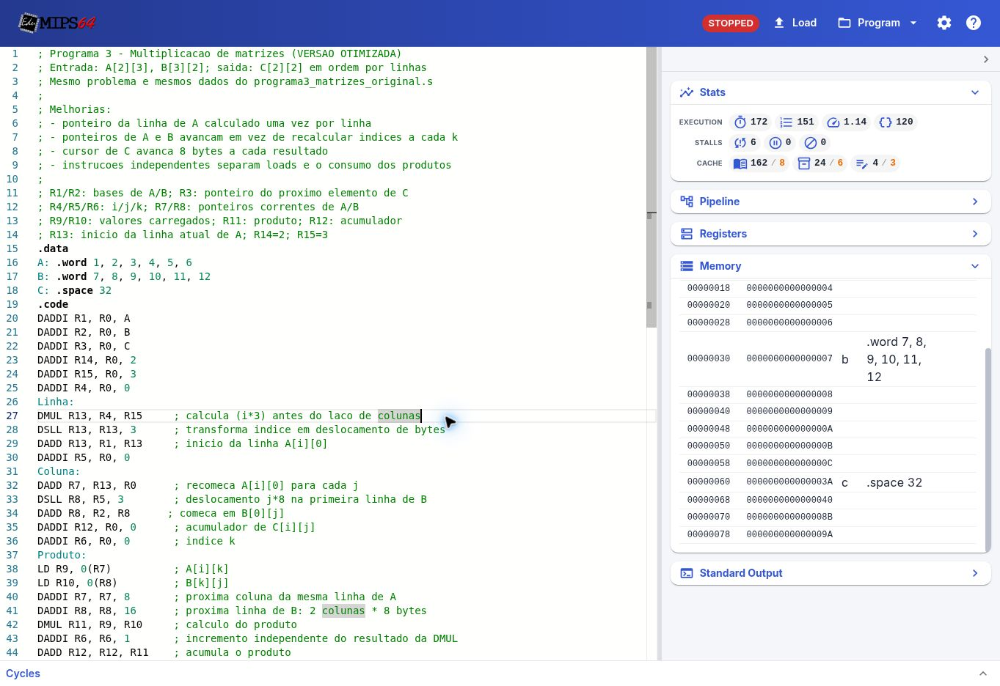

A captura mostra a saída C = [[58,64],[139,154]] na mesma execução ON. Ela resolve a pendência da captura antiga, que terminava antes da região C. A imagem composta anterior permanece apenas como registro histórico. A validação é para a entrada testada, não uma prova para todas as entradas.

# 13. Discussão dos resultados

As respostas preservam os resultados medidos das seções 4–11. A seção 12 acrescenta seis medições reais para N=10,20,50 e a captura completa da memória otimizada ON.

**1. Qual foi o impacto do forwarding no total de ciclos?** O forwarding eliminou ou reduziu esperas por resultados de instruções anteriores: no Programa 1, **94→72** ciclos (−23,4%); no Programa 2, **85→73** (−14,1%); e no Programa 3 original, **540→262** (−51,5%). Na versão otimizada do Programa 3, **214→172** (−19,6%). O experimento ideal foi 9→9 porque não havia dependências a resolver.

**2. Qual foi o impacto sobre o CPI?** Nos mesmos programas, o IC não mudou ao alternar forwarding, então o CPI acompanhou a redução de CC. No Programa 1, **1,81→1,38**; no Programa 2, **1,98→1,70**; no Programa 3 original, **2,49→1,21**; e no otimizado, **1,42→1,14**.

**3. Quais dependências tiveram a penalidade reduzida?** Na cadeia de somas DADDI→DADD do experimento 4.2, os seis stalls RAW desapareceram. Nos programas, o encaminhamento mitigou RAW entre cálculos de endereço, operações aritméticas, loads e seus consumidores, além de atualizações de índices. Não alterou a necessidade lógica de consumir os resultados; apenas antecipa sua disponibilidade no pipeline.

**4. Por que ainda há stalls com forwarding?** Um `LD` só disponibiliza o dado após o acesso em MEM e o consumidor imediatamente seguinte pode precisar do operando antes disso. No experimento 4.3 original, permaneceu **1 stall** com ON. Nos programas, a versão otimizada do Programa 3 ainda teve **6 RAW stalls** com ON, envolvendo outras dependências, inclusive condições de laço e situações que não são resolvidas por todos os caminhos de forwarding.

**5. Impacto dos desvios condicionais?** Os branches alteram o fluxo de busca e podem desperdiçar ciclos ao redirecionar o pipeline. O experimento 4.4 fez 10 testes, 9 tomados, e apresentou um **resíduo líquido de controle de 9 ciclos** em ambas as configurações. Em nossos programas os resíduos modelados são 4 (soma), 8 (contagem) e 11 (matrizes). Como o Stats não mostrou contador próprio de branch stalls, os valores são inferências compatíveis com os fluxos, não medições diretas.

**6. Onde havia instruções independentes?** No Programa 3 otimizado, os incrementos dos ponteiros `R7` e `R8` independem dos valores `R9` e `R10` carregados pelos loads, desde que ocorram depois deles para preservar os endereços lidos. O incremento de `R6` é independente do resultado da multiplicação, podendo ficar entre `DMUL` e a `DADD` consumidora. No experimento 4.3, o `DADDI R5` independente pôde ocupar a bolha do load-use.

**7. A reordenação reduziu stalls?** Sim. Na comparação do Programa 3 original→otimizado, os RAW stalls caíram de **308→48** com OFF (−84,4%) e de **30→6** com ON (−80,0%). A redução resulta da reordenação útil e também da substituição de recálculos por ponteiros, não apenas da troca de ordem de linhas.

**8. A otimização alterou o IC?** Sim. As instruções dinâmicas do Programa 3 caíram de **217 para 151** (−30,4%), porque o laço interno passou a gastar menos operações por produto. O problema, as dimensões e a saída permaneceram iguais no teste documentado.

**9. Qual foi o speedup observado?** Original→otimizado do Programa 3: `540/214 ≈ 2,52×` com forwarding OFF e `262/172 ≈ 1,52×` com ON. Se combinarmos as duas mudanças, de original OFF para otimizado ON, `540/172 ≈ 3,14×`, sem atribuir o ganho combinado a uma única intervenção.

**10. Reduzir CPI garante redução proporcional do tempo?** Não. O número total de ciclos é `IC × CPI`, e o tempo estimado também depende do período de clock. No experimento 4.3, a reordenação com ON reduziu o CPI de **2,25 para 1,80** mas o total ficou **9 ciclos nas duas versões**, pois IC aumentou de 4 para 5. Nas versões do Programa 3 o IC mudou muito, portanto calculamos speedup pelos ciclos, não somente pelo CPI.

**11. Quais mudanças mais impactaram o desempenho e por quê?** O maior resultado combinado veio de **eliminar operações redundantes dentro do laço do Programa 3** e **usar forwarding onde havia dependências longas**. A reorganização reduziu a quantidade de instruções em 66 e encurtou cadeias RAW; com OFF, os 326 ciclos economizados correspondem exatamente a **66 instruções + 260 RAW stalls** a menos, mantendo o mesmo resíduo de controle inferido. O forwarding no código original reduziu 278 stalls RAW e, correspondentemente, 278 ciclos (**540→262**), enquanto no código já otimizado reduziu 42. Essas comparações mostram que reduzir trabalho redundante e aproveitar ILP são complementares.

# 14. Guia de reprodução do experimento

A experiência foi conduzida no EduMIPS64 Web, https://web.edumips.org/. O build das capturas anteriores não foi registrado. Nesta revisão, Help > About identificou **1.4.0-223-gce45a8d9**, production, para as seis novas medições e a memória otimizada ON (23/10/2026). A versão Java/CLI não foi usada nesta coleta.

**Configuração registrada (ver seção 3.2):** Forwarding OFF e ON em corridas separadas; Branch Delay Slot OFF; cache L1 de instruções 1024 bytes, blocos de 16 bytes, associatividade 1; cache L1 de dados com os mesmos parâmetros. Outras configurações devem permanecer iguais entre os pares.

**Procedimento:**

1. Acessar o EduMIPS64 Web e abrir o arquivo `.s` correspondente pelo menu Program > Open (ou colar no editor).
2. Acessar o botão de **engrenagem > General Settings**; desativar **Branch Delay Slot** e definir **CPU Forwarding OFF**. Revisar os parâmetros de cache acima.
3. Clicar em **Load**, conferindo ausência de erro do montador. Para o estudo ciclo a ciclo, acionar **Single Step** e inspecionar os estágios do **Pipeline** e o histórico de **Cycles**; para execução integral, clicar em **Run All**.
4. Ao terminar, usar **Stats** para registrar ciclos totais (CC), instruções dinâmicas (IC), stalls RAW, WAW e estruturais; calcular CPI = CC/IC. Não confundir contadores de hits/misses de cache com stalls de pipeline. Se o contador específico de branch stalls não existir, preencher **N/D**.
5. Conferir **Memory** (ou **Registers**, no microexperimento sem saída em memória) contra a tabela de saídas; salvar capturas com nome do arquivo, forwarding e dimensão de entrada.
6. Recarregar o mesmo `.s` após alternar **CPU Forwarding ON**, mantendo as entradas e outras opções, repetir Step/Run All, conferir memória e coletar Stats.
7. Para reproduzir a seção 10, executar `programa3_matrizes_original.s` e `programa3_matrizes_otimizado.s` com ambas as configurações. Para a seção 12, executar N=5, 10, 20 e 50, conforme o procedimento do item 12.1.
8. Consolidar os resultados no CSV de medição e atualizar as tabelas do relatório **somente depois das simulações**, identificando diferenças entre observado e projetado.

**Entradas e saídas de referência:**

| Arquivo | Entrada | Saída esperada |
|---|---|---|
| `programas/programa1_soma_vetores.s` | `A=[1,2,3,4,5]`, `B=[10,20,30,40,50]`, N=5 | `C=[11,22,33,44,55]` |
| `programas/programa2_contagem.s` | vetor `[4,7,4,2,4,9]`, alvo=4, N=6 | resultado=3 |
| `programas/programa3_matrizes_original.s` e `_otimizado.s` | A 2×3 e B 3×2 da seção 5.3 | `C=[[58,64],[139,154]]` |
| `experimentos_tamanho/programa1_n05.s`, `_n10.s`, `_n20.s`, `_n50.s` | `A[i]=i+1`, `B[i]=10(i+1)` | `C[i]=11(i+1)` |

Nos microexperimentos, os valores de referência são: 4.1 `R1..R4=(10,20,30,40)`; 4.2 `R1..R4=10`; 4.3 `R3=7` (na variante com `DADDI`, `R5=100`); 4.4 `R1=0, R2=10`.

**Validação adicional local:** com Python 3, na raiz do repositório, executar `python3 scripts/validar_funcional.py`. O script confirma os valores na memória e a contagem de instruções dinâmicas para as oito entradas testadas, mas não substitui a execução no EduMIPS64 para obter ciclos e stalls.

# 15. Arquivos da entrega e evidências

A entrega inclui os códigos originais, relatório atualizado, tabelas de medições reais, seis capturas de Stats de N=10/20/50 e a captura completa da matriz otimizada ON. Os cinco integrantes e os resultados anteriores foram preservados. As pendências desta revisão foram concluídas; o build da nova coleta foi 1.4.0-223-gce45a8d9.

## Fontes de consulta

- Enunciado do professor: [`enunciado/TP1_EduMIPS64.pdf`](enunciado/TP1_EduMIPS64.pdf).
- Documentação oficial do EduMIPS64: <https://edumips64.readthedocs.io/en/latest/> (formato de fontes, ISA e opções de interface).
- Simulador Web: <https://web.edumips.org/>.

